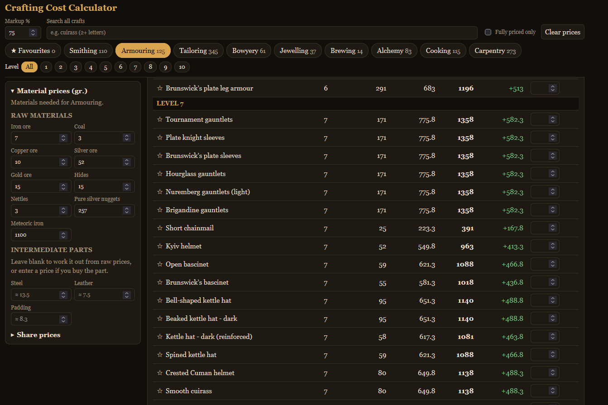
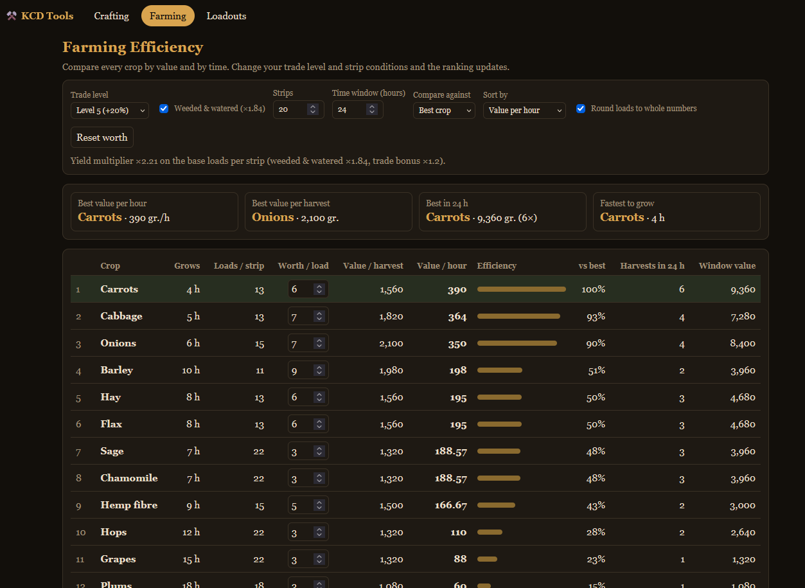
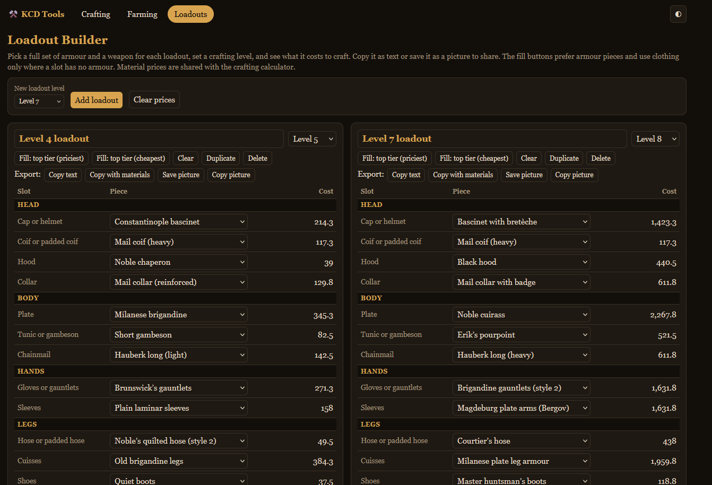

# KCD Tools

[](https://github.com/xBusterguy/KCDCalculator/actions/workflows/check-recipes.yml)
[](LICENSE)

Calculators for **KCD Roleplay** (Kingdom Come: Deliverance II): work out what things cost to craft, which crops earn the most, and what a full set of armour costs to make.

### 👉 [Open the site](https://xbusterguy.github.io/KCDCalculator/)

Everything runs in your browser. There is no account and nothing is sent anywhere. Your prices and settings are saved on your own device.

## Crafting cost calculator



- All nine crafts: Smithing, Armouring, Tailoring, Bowyery, Jewelling, Alchemy, Brewing, Cooking and Carpentry (1,163 pieces).
- Enter your material prices and see each piece's cost, bench fee, selling price and profit at your markup.
- Intermediate parts such as steel, leather and padding are worked out from raw materials, or use your own price.
- Build an order and get a combined shopping list.
- Star favourites, search across every craft, and share or import price lists as plain text.

## Farming efficiency



- Compare every crop by value per hour, value per harvest and value in a time window.
- Set your trade level, whether strips are weeded and watered, how many strips you have, and your own selling prices.

## Loadout builder



- Set up several loadouts at different crafting levels: 12 armour sections plus a weapon and a shield.
- See what each costs to make and get a shopping list of materials.
- Copy a loadout as text for a chat, or save it as a picture.

## Found a mistake?

Recipes were copied by hand from the [KCD Roleplay wiki](https://wiki.kcdroleplay.com/recipes/), so some may be wrong.

- [Report a wrong recipe or a bug](../../issues/new/choose)
- Or message **Busterguy** on Discord.

Want to fix a recipe yourself? See [CONTRIBUTING.md](CONTRIBUTING.md). All recipes are in one file, `assets/recipes.js`, and an automatic check catches typos.

## Project layout

```
index.html        home page
crafting.html     crafting cost calculator
farming.html      farming efficiency
loadouts.html     loadout builder
404.html          page not found
assets/recipes.js every crafting recipe (edit recipes here only)
scripts/          recipe checker
```

It is a static site with no build step. To run it locally, download the repository and open `index.html`, or run `python3 -m http.server` in the folder and visit `http://localhost:8000`.

## Credits and licence

Made by **Busterguy**. Released under the [MIT licence](LICENSE).

Recipe and crop data comes from the [KCD Roleplay wiki](https://wiki.kcdroleplay.com/). This is an unofficial fan project and is not affiliated with the wiki, Warhorse Studios or Deep Silver.
