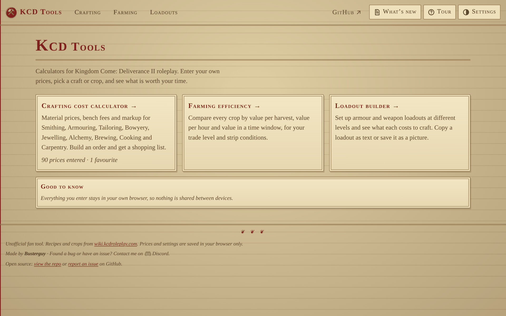

# KCD Tools

[](https://github.com/xBusterguy/KCDCalculator/actions/workflows/check-recipes.yml)
[](LICENSE)

Calculators for **KCD Roleplay** (Kingdom Come: Deliverance II): work out what things cost to craft, which crops earn the most, and what a full set of armour costs to make.

### 👉 [Open the site](https://xbusterguy.github.io/KCDCalculator/)

Everything runs in your browser. There is no account and nothing is sent anywhere. Your prices and settings are saved on your own device. The site uses a Medieval ledger look, with a light and a dark mode in the settings menu (top right).



## Crafting cost calculator


- All nine crafts: Smithing, Armouring, Tailoring, Bowyery, Jewelling, Alchemy, Brewing, Cooking and Carpentry (1,163 pieces).
- Enter your material prices and see each piece's cost, bench fee, selling price and profit at your markup.
- Intermediate parts such as steel, leather and padding are worked out from raw materials, or use your own price.
- Sort by any column, star favourites, and search across every craft.
- Build an order and get a combined shopping list.
- Save named price presets (for example one per town), and share or import price lists as plain text.

## Farming efficiency


- Compare every crop by value per hour, value per harvest and value in a time window.
- Set your trade level, whether strips are weeded and watered, how many strips you have, and your own selling prices.
- Quick-setup buttons, a top 3 chart, and a note on how every number is worked out.

## Loadout builder


- Set up several loadouts at different crafting levels: 12 armour sections plus a weapon and a shield.
- The fill buttons pick the highest-tier pieces and prefer armour, using clothing only where a slot has no armour.
- Find a piece by name, compare loadouts side by side, and undo clears, deletes and fills.
- See what each costs to make and get a shopping list of materials.
- Copy a loadout as text or as a link, or save it as a picture.

## Everywhere

- Tables turn into cards on phones.
- Back up and restore all your prices, orders, favourites and loadouts from the settings menu.
- Press `/` to jump to search, Enter moves to the next price box, and there is a skip-to-content link.
- After the first visit the site is kept in your browser, so it opens instantly and works without a connection. A new version appears on the visit after it is published (`sw.js`).
- The **What's new** button (next to GitHub) lists recent changes from `changelog.json`; a small dot shows when there is something you have not seen.
- A guided tour of every page is offered on a first visit and can be replayed any time with the **Tour** button next to Settings.

## Recipes update themselves

A GitHub Action (`.github/workflows/wiki-sync.yml`) reads the [recipes page on the wiki](https://wiki.kcdroleplay.com/recipes/) every day and compares it with `assets/recipes.js`. If anything differs it opens a pull request called **Update recipes from the wiki** that lists every new, removed and changed piece. Check the list, press **Merge**, and the site updates itself.

- To check right now: open the **Actions** tab, choose **Check wiki for recipe changes**, press **Run workflow**.
- One-time setting: **Settings → Actions → General → Workflow permissions**, tick **Allow GitHub Actions to create and approve pull requests**.
- If the Action cannot read the wiki, or a change needs a person (for example a brand new material name), it opens an issue instead and explains what to do.
- You can run the same check on your own computer with `node scripts/wiki-sync.js`. Add `--apply` to rewrite `assets/recipes.js`.

## Found a mistake?

- [Report a wrong recipe or a bug](../../issues/new/choose)
- Or message **Busterguy** on Discord.

Want to fix a recipe yourself? See [CONTRIBUTING.md](CONTRIBUTING.md). All recipes are in one file, `assets/recipes.js`, and an automatic check catches typos.

## Project layout

```
index.html          home page
crafting.html       crafting cost calculator
farming.html        farming efficiency
loadouts.html       loadout builder
404.html            page not found
assets/recipes.js   every crafting recipe (edit recipes here only)
assets/categories.js   how the crafting page groups pieces into types (Swords, Helmets, Furniture...)
assets/tour.js         the guided tour (one list of steps, edit the text there)
changelog.json     the list shown by the What's new button (add new entries at the top)
sw.js               saves the site in the browser for fast repeat visits and offline use
assets/social.png   picture shown when a link is shared in Discord or chat
robots.txt, sitemap.xml   help search engines find the pages
scripts/            recipe checker and wiki sync
docs/screenshots/   images used in this README
.github/            workflows, issue forms and pull request template
CONTRIBUTING.md     how to fix a recipe
LICENSE             MIT licence
```

It is a static site with no build step. To run it locally, download the repository and open `index.html`, or run `python3 -m http.server` in the folder and visit `http://localhost:8000`.

## Credits and licence

Made by **Busterguy**. Released under the [MIT licence](LICENSE).

Recipe and crop data comes from the [KCD Roleplay wiki](https://wiki.kcdroleplay.com/). This is an unofficial fan project and is not affiliated with the wiki, Warhorse Studios or Deep Silver.
